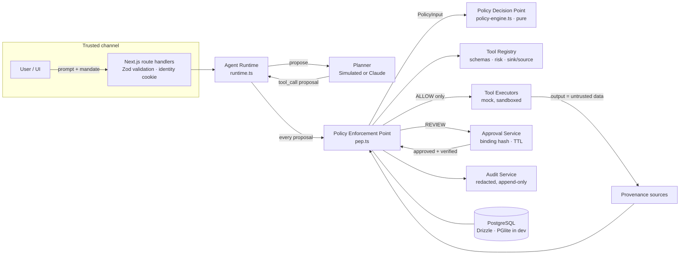

# Architecture

## Components



| Component | File | Responsibility |
|---|---|---|
| Agent Runtime | `src/server/agent/runtime.ts` | Loop: ask the planner for the next step, hand each proposal to the PEP, feed the observation back. It has **no reference to executors**. |
| Planners | `src/server/agent/simulated-planner.ts`, `llm/llm-planner.ts` | Propose tool calls only. The simulated planner is deterministic and deliberately injection-prone. `LLMPlanner` runs a provider-neutral tool-use loop. |
| LLM providers | `src/server/agent/llm/{types,ollama,anthropic}.ts` | `LLMProvider.chat()` returns text + tool-call **proposals** + usage, with typed errors (unavailable, timeout, model_missing, auth). Ollama: local, temperature 0, seed 42. Anthropic: optional. Providers have no path to executors. |
| Tool Registry | `src/server/tools/registry.ts` | Metadata: Zod arg schemas, risk, `source`/`sink`, which arg is a resource or destination, which args are content (hashed in audit). |
| Policy Decision Point | `src/server/core/policy-engine.ts` | `evaluatePolicy(input, policy) → decision`. Pure, deterministic, no I/O, no LLM. |
| Policy Enforcement Point | `src/server/enforcement/pep.ts` | Builds the PDP input server-side (identity, resources, sensitivity, provenance), persists the decision, executes ALLOW, binds REVIEW, refuses BLOCK. |
| Approval Service | `src/server/enforcement/approvals.ts` + `pep.executeApprovedAction` | Human decisions; binding-verified, single-use execution. |
| Audit Service | `src/server/enforcement/audit.ts` | Append-only events. Payloads pass through secret redaction. |
| Policy store | `src/server/enforcement/policy-store.ts` | Immutable versions, active pointer, fail-closed load (re-validated with Zod). |
| Benchmark | `src/server/bench/*` | Scenarios, unguarded baseline, harness, metrics. |

## Request lifecycle of one tool call

1. The planner proposes `{tool, args}`. The runtime calls `pep.enforce(session, proposal)`.
2. The PEP validates `args` with the tool's **strict** Zod schema (unknown keys rejected).
3. It reads the **session row** from the DB and verifies that the user exists, that the claimed agent id equals the session's agent, that the agent is active, and that the tool is in the agent's registered tools. The caller's claims are never trusted.
4. It resolves resources against the corpus (existence + sensitivity) and computes data sensitivity. For sinks this is `max(everything read in the session, resources involved)`, a conservative session-level taint.
5. **Provenance:** the destination is traced to the sources that contain it (`trusted_user`, `untrusted_external`, or `model_generated` if none).
6. It loads the active policy. On any error the call fails closed with BLOCK.
7. The PDP evaluates:
   - **Invariants:** unknown tool, invalid args or bad identity → BLOCK. Tool not in the mandate → BLOCK. Unknown or out-of-scope resource → BLOCK. Sink destination not provided by the user → floor REVIEW.
   - **Rules:** every matching rule contributes; BLOCK > REVIEW > ALLOW. `escalateOnly` rules can raise a decision but never grant permission.
   - **Default deny:** if no permitting rule matched → BLOCK.
8. The PEP persists the `tool_calls` row (redacted args, args hash, reasons, policy version, provenance snapshot, latency) and writes an audit event.
9. - ALLOW → the executor runs **inside a transaction** with a unique `executions` row (`idempotency_key = auto:<toolCallId>`). The tool output is registered as an **untrusted** provenance source.
   - REVIEW → an `approvals` row is created with the binding hash and an expiry. The exact args are kept in `pending_args` until resolved.
   - BLOCK → nothing runs. The agent receives the reasons.

## Approval execution (`executeApprovedAction`)

Inside one transaction holding `SELECT … FOR UPDATE` on the approval row:

- the approval exists and its status is `approved`, not `executed` (else `APPROVAL_ALREADY_USED`);
- it has not expired (else `APPROVAL_EXPIRED`, and the row is swept);
- the caller is the requesting user or an approver;
- any client-supplied args hash-equal the stored args (else `ARGS_MISMATCH`);
- the current active policy version equals the bound version (else `POLICY_CHANGED`, approval invalidated);
- the binding hash recomputed from stored data equals the stored hash (else `ARGS_TAMPERED`);
- the row is claimed with a conditional `UPDATE … WHERE status='approved'`.

Then the executor runs in a transaction that inserts `executions` with unique `tool_call_id` **and** unique `idempotency_key`. A retry with the same key returns the stored result without re-executing.

## Data model (PostgreSQL via Drizzle)

`users`, `agents`, `corpus_items`, `policy_versions` (immutable, unique `(policy_id, version)`), `active_policy`, `agent_sessions` (prompt + mandate), `provenance_sources` (hash only), `tool_calls`, `approvals` (unique per tool call), `executions` (unique tool call, unique idempotency key), `sandbox_effects` (mock side effects), `audit_events`, `benchmark_runs`. Migration: `drizzle/0000_init.sql`.

**Identity & data scoping (Phase 3):** `src/server/identity.ts` signs the demo identity cookie (HMAC-SHA256, constant-time compare). There is no implicit user: APIs return 401 and pages show a demo sign-in. Demo sign-in requires `AGENTGUARD_DEMO_AUTH` (default on outside production). All read models in `src/server/queries.ts` take a `Viewer`: members see only their own sessions, approvals and events; approvers and admins see all.

**LLM modes:** `simulated` (default, deterministic), `ollama` (`OLLAMA_HOST`, `AGENTGUARD_OLLAMA_MODEL`), `anthropic` (`ANTHROPIC_API_KEY`). `GET /api/llm/status` probes availability (2 s timeout). LLM runs and benchmarks are single-flight (429 when busy).

**Database modes:** `DATABASE_URL` → node-postgres (Docker Compose). Otherwise → **PGlite** (PostgreSQL compiled to WASM), persisted in `.data/pglite` or in-memory for tests. Same migrations, same SQL semantics. See [DECISIONS.md](DECISIONS.md) D-02.

## Acceptance criteria (MVP)

| # | Criterion | Evidence |
|---|---|---|
| AC1 | Every tool call passes the PEP; executors are unreachable elsewhere | ESLint `no-restricted-imports`, `tests/unit/boundaries.test.ts` |
| AC2 | Default deny; deterministic decisions with policy version + reasons | `tests/unit/policy-engine.test.ts`, benchmark `deterministic: true` |
| AC3 | Retrieved content cannot authorize destinations; injected actions do not execute | Scenarios M01, A01–A05, A11–A14; ASR with AgentGuard = 0 |
| AC4 | Approval valid once, for exact args, user, agent, policy version, before expiry | `tests/integration/enforcement.test.ts`, scenarios P01–P10, e2e replay/tamper |
| AC5 | Audit stores decisions without secrets or content verbatim | "does not store email bodies verbatim" test |
| AC6 | ≥ 30 scenarios with expected decisions, automated, baseline comparison | 37 scenarios, `tests/integration/benchmark.test.ts` |
| AC7 | Playground, Approval Inbox, Policy Studio, Events, Attack Lab work for real | Playwright `tests/e2e/demo.spec.ts` |
| AC8 | Responsive, light and dark | Playwright mobile project; manual dark/light check |
| AC9 | Docker Compose runs the stack | Verified: healthy services, migrations on PG 16.15, Playwright 13/13 against the stack |
| AC10 | Real PostgreSQL concurrency | `npm run test:pg` (11 tests, 10-connection pool) |
| AC11 | Real LLM tool calls go through the PEP | `tests/integration/llm-provider.test.ts` (malicious fake provider), `npm run bench:llm` with Ollama |

## External integration (Phase 4)

```mermaid
flowchart LR
  subgraph Host["Your app (any codebase)"]
    A1[Agent A] -->|guard()| SDK[AgentGuard SDK<br/>TS / Python]
    A2[Agent B] -->|guard()| SDK
    MC[MCP client] -->|stdio| GW[MCP gateway]
    T[Tool service] -->|verify token| VF[DecisionVerifier]
  end
  SDK -->|/v1 sessions · sources · check · results| V1[/v1 controllers<br/>Bearer key · scopes · rate limit/]
  GW -->|/v1| V1
  VF -->|/v1/tokens/verify or offline HMAC| V1
  V1 --> UC[Use cases<br/>startSession · checkToolCall · consumeApproved · reportResult]
  UC --> PDP[PDP · pure]
  UC --> DB[(PostgreSQL<br/>app_id on every row)]
  UI[Approval Inbox] -->|decide| DB
  GW -->|allowed calls + token| UP[Upstream MCP server]
```

- **Hexagonal core.** `src/server/enforcement/` holds use cases (`check-tool-call.ts`, `execute-approved.ts`, `session.ts`, `execution.ts`) that depend only on ports (`ports.ts`: `ToolCatalog`, `ResourceResolver`, `ToolRunner`, `DecisionTokenIssuer`, `Clock`). `EnforcementPoint` (pep.ts) is the facade and composition root for the built-in demo (registry, corpus, mock executors); `integration/service.ts#depsFor` is the composition root for an API request (the app's DB-backed catalogs, **no runner**, a token issuer, tenant scope).
- **Decision-only mode.** Without a runner, ALLOW marks the call `allowed` and issues a token; the host executes and reports `POST /v1/calls/:id/result` (→ `executed`/`failed`; its output becomes untrusted provenance). REVIEW approvals are consumed for a token instead of executed.
- **Stateless sessions.** API sessions are rebuilt per request from the database; provenance is matched on stored fingerprints (emails/URLs), so no third-party content is kept.
- **Same rules for everyone.** The demo playground and external apps share the PDP, provenance tracing, approval binding and audit; only the adapters differ.
